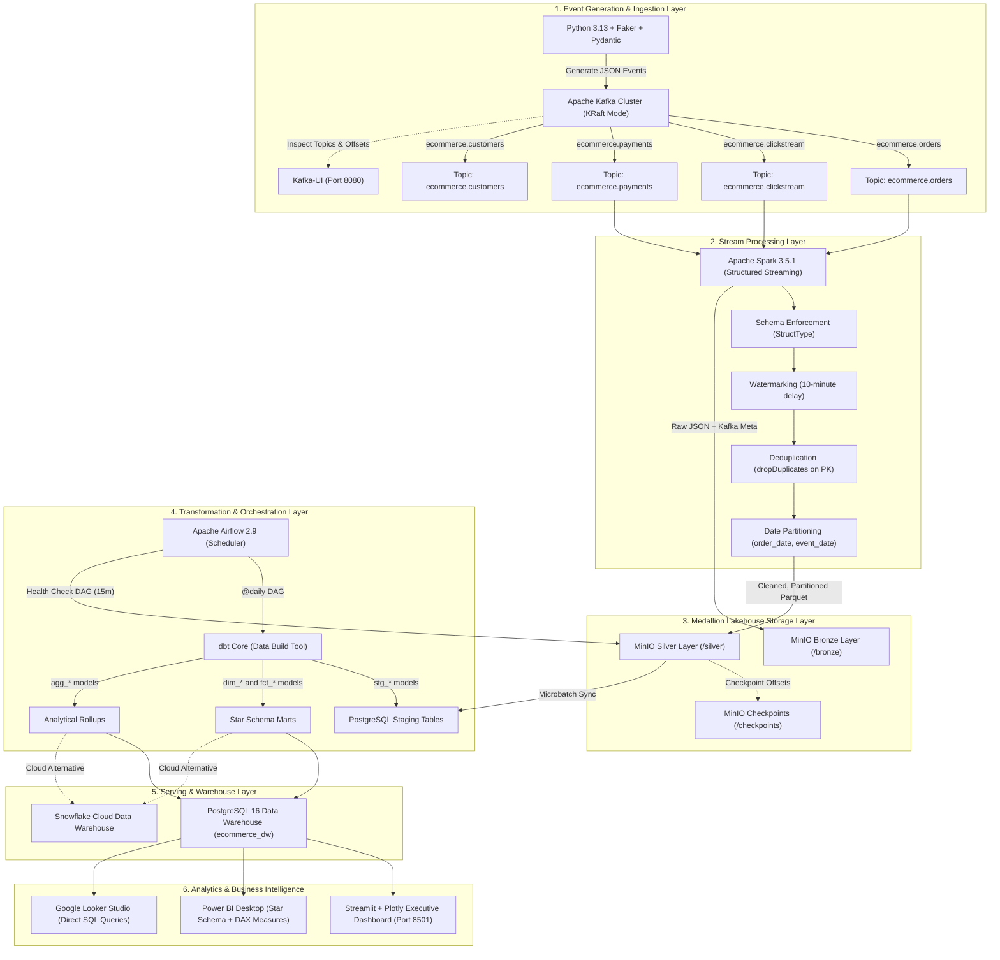
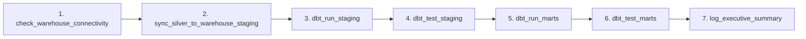

# Streaming E-Commerce Data Platform: Complete Technology & Architecture Deep Dive

An exhaustive, end-to-end technical reference documenting every component, framework, data model, and technology used in the **Streaming E-Commerce Data Platform**.

---

## 1. System Architecture Diagram



---

## 2. Technology-by-Technology Breakdown

---

### 1. Python 3.13, Faker & Pydantic (Event Generation & Schema Validation)

| Attribute | Details |
| :--- | :--- |
| **Technology** | **Python 3.13**, **Faker**, **Pydantic v2** |
| **Role in Pipeline** | Generates real-time synthetic customer journeys, validates event schemas, serializes JSON. |
| **Files in Codebase** | [`producers/generator.py`](file:///C:/Users/DELL/.gemini/antigravity/scratch/streaming-ecommerce-platform/producers/generator.py), [`producers/schema.py`](file:///C:/Users/DELL/.gemini/antigravity/scratch/streaming-ecommerce-platform/producers/schema.py), [`producers/config.py`](file:///C:/Users/DELL/.gemini/antigravity/scratch/streaming-ecommerce-platform/producers/config.py) |

#### Why It Was Chosen:
- **Faker**: Generates realistic names, email addresses, US cities, states, and product titles without using sensitive real-world customer PII.
- **Pydantic v2**: High-performance data validation engine written in Rust core (`pydantic-core`). Enforces data types, positive prices, valid timestamps, and enum boundaries before messages are emitted to Kafka.

#### How It Works:
1. **Catalog Initialization**: Pre-generates 500 customers across real US states and 80 product SKUs across 5 realistic categories (Electronics, Apparel, Home & Kitchen, Books, Sports & Outdoors).
2. **Funnel Simulation Engine**: Emulates a real e-commerce user browsing session with probabilistic drop-offs:
   $$\text{Product View } (100\%) \xrightarrow{40\%} \text{Add to Cart } \xrightarrow{60\%} \text{Checkout } \xrightarrow{75\%} \text{Purchase}$$
3. **Data Quality Simulation**: Injects a controlled percentage (3-5%) of duplicated event IDs and network retry events to verify downstream Spark streaming deduplication.

---

### 2. Apache Kafka & Kafka-UI (Distributed Event Streaming)

| Attribute | Details |
| :--- | :--- |
| **Technology** | **Apache Kafka 7.5.3 (Confluent CP)** in **KRaft Mode** + **Kafka-UI v0.7.2** |
| **Role in Pipeline** | Real-time decoupled message buffer and distributed event log. |
| **Files in Codebase** | [`docker-compose.yml`](file:///C:/Users/DELL/.gemini/antigravity/scratch/streaming-ecommerce-platform/docker-compose.yml), [`producers/kafka_producer.py`](file:///C:/Users/DELL/.gemini/antigravity/scratch/streaming-ecommerce-platform/producers/kafka_producer.py) |

#### Why It Was Chosen:
- **KRaft Mode (Kafka Raft)**: Modern Kafka architecture that eliminates the need for Apache ZooKeeper. Runs the metadata controller directly inside the broker for faster startup, simplified maintenance, and lower memory footprint.
- **High Throughput & Durability**: Implements append-only partitioned commit logs, guaranteeing message ordering per customer key and zero data loss.
- **Kafka-UI**: Web-based administration console running on port `8080` to inspect topics, partitions, consumer lag, and raw payloads.

#### Topics Configured:
1. `ecommerce.clickstream`: High-volume click events (`view`, `add_to_cart`, `checkout`), partitioned by `customer_id`.
2. `ecommerce.orders`: Completed order transactions (`order_id`, `quantity`, `total_amount`), keyed by `order_id`.
3. `ecommerce.payments`: Financial settlement records (`payment_id`, `payment_method`, `payment_status`).
4. `ecommerce.customers`: Master demographic catalog data.

---

### 3. Apache Spark & PySpark Structured Streaming (Stream Processing Engine)

| Attribute | Details |
| :--- | :--- |
| **Technology** | **Apache Spark 3.5.1**, **PySpark**, **Spark SQL Kafka Connector** |
| **Role in Pipeline** | Ingests unbounded streams from Kafka, validates schema on read, enforces event-time watermarks, deduplicates records, and partitions data. |
| **Files in Codebase** | [`spark/streaming_pipeline.py`](file:///C:/Users/DELL/.gemini/antigravity/scratch/streaming-ecommerce-platform/spark/streaming_pipeline.py), [`spark/schemas/event_schemas.py`](file:///C:/Users/DELL/.gemini/antigravity/scratch/streaming-ecommerce-platform/spark/schemas/event_schemas.py), [`spark/utils/quality_checks.py`](file:///C:/Users/DELL/.gemini/antigravity/scratch/streaming-ecommerce-platform/spark/utils/quality_checks.py) |

#### Why It Was Chosen:
- **Exactly-Once Semantics**: Combines Kafka offsets with MinIO checkpointing to guarantee that every event is written exactly once into the lakehouse.
- **Event-Time Processing**: Uses the event's original timestamp (`order_timestamp`) rather than arrival time, properly handling out-of-order and network-delayed events.
- **Unified Engine**: Same DataFrame API processes streaming micro-batches and historical batch queries seamlessly.

#### Key Streaming Transformations:
1. **Schema-on-Read**: Parses Kafka binary `value` using explicit PySpark `StructType` definitions:
   ```python
   raw_orders.select(from_json(col("value").cast("string"), ORDER_SCHEMA).alias("data")).select("data.*")
   ```
2. **Watermarking**: Sets a 10-minute watermark threshold to limit state store memory while accommodating late data:
   ```python
   df.withWatermark("order_timestamp", "10 minutes").dropDuplicates(["order_id"])
   ```
3. **Partitioning**: Extracts `order_date = to_date(order_timestamp)` and writes to MinIO with `.partitionBy("order_date")`.

---

### 4. MinIO (S3-Compatible Object Storage Data Lake)

| Attribute | Details |
| :--- | :--- |
| **Technology** | **MinIO Community Server**, **MinIO Client (`mc`)** |
| **Role in Pipeline** | Scalable, cloud-native S3-compatible data lake storage holding Bronze, Silver, and Gold data layers. |
| **Files in Codebase** | [`minio/create_buckets.sh`](file:///C:/Users/DELL/.gemini/antigravity/scratch/streaming-ecommerce-platform/minio/create_buckets.sh), [`spark/utils/spark_session.py`](file:///C:/Users/DELL/.gemini/antigravity/scratch/streaming-ecommerce-platform/spark/utils/spark_session.py) |

#### Why It Was Chosen:
- **S3 API Compatibility**: 100% compatible with Amazon AWS S3, allowing identical Spark code to run locally on MinIO or in AWS S3 without code modifications.
- **High Performance**: Written in Go, capable of gigabytes-per-second read/write speeds.
- **Built-in Web Console**: Accessible at `http://localhost:9001` for graphical bucket and file browsing.

#### Medallion Lakehouse Architecture:
- **Bronze Layer (`s3a://ecommerce-lake/bronze/`)**: Stores the raw event payload string along with Kafka metadata (`kafka_partition`, `kafka_offset`, `bronze_ingested_at`). Acts as an immutable audit trail.
- **Silver Layer (`s3a://ecommerce-lake/silver/`)**: Cleaned, typed, deduplicated columnar Parquet files, partitioned by date (`order_date=YYYY-MM-DD/`).
- **Checkpoints (`s3a://ecommerce-lake/checkpoints/`)**: Spark Structured Streaming write-ahead logs and offset state stores for fault-tolerant recovery.

---

### 5. dbt Core (Data Build Tool - SQL Modeling & Testing)

| Attribute | Details |
| :--- | :--- |
| **Technology** | **dbt-core 1.8+**, **dbt-postgres** |
| **Role in Pipeline** | Transforms staged raw lake data into dimensional Star-Schema marts, generates analytics rollups, and enforces data quality tests. |
| **Files in Codebase** | [`dbt_ecommerce/dbt_project.yml`](file:///C:/Users/DELL/.gemini/antigravity/scratch/streaming-ecommerce-platform/dbt_ecommerce/dbt_project.yml), [`dbt_ecommerce/models/staging/`](file:///C:/Users/DELL/.gemini/antigravity/scratch/streaming-ecommerce-platform/dbt_ecommerce/models/staging), [`dbt_ecommerce/models/marts/`](file:///C:/Users/DELL/.gemini/antigravity/scratch/streaming-ecommerce-platform/dbt_ecommerce/models/marts) |

#### Why It Was Chosen:
- **Software Engineering Best Practices for SQL**: Provides version control, modular CTEs, automated dependency graph resolution (DAG), and environment switching (dev/prod).
- **Automated Data Quality & Schema Testing**: Validates integrity constraints (`not_null`, `unique`, `relationships`, `accepted_values`) with a single command (`dbt test`).

#### dbt Model Hierarchy:
1. **Staging Layer (`models/staging/`)**:
   - `stg_orders.sql`: Casts types, deduplicates on `order_id` with `ROW_NUMBER()`, filters non-positive quantities.
   - `stg_clickstream.sql`: Cleans actions, standardizes referrers, normalizes device names.
   - `stg_payments.sql`, `stg_customers.sql`, `stg_products.sql`.
2. **Core Marts - Star Schema (`models/marts/core/`)**:
   - `dim_customers.sql`: Customer dimension with surrogate key `customer_key`.
   - `dim_products.sql`: Product dimension with surrogate key `product_key`.
   - `dim_date.sql`: Calendar date spine with day, month, quarter, year, and weekend flags.
   - `fct_orders.sql`: Joins staging orders with dimensions to produce foreign keys and revenue measures.
   - `fct_clickstream.sql`: Joins clickstream events with dimensions to map user funnel sessions.
3. **Analytics Marts (`models/marts/analytics/`)**:
   - `agg_daily_sales.sql`: Daily total revenue, orders count, units sold, and AOV.
   - `agg_conversion_funnel.sql`: Conversion rates across view ➔ cart ➔ checkout ➔ purchase.
   - `agg_customer_rfm.sql`: Recency, frequency, and monetary spend ranking per customer.

---

### 6. PostgreSQL 16 & Snowflake (Data Warehousing)

| Attribute | Details |
| :--- | :--- |
| **Technology** | **PostgreSQL 16 Alpine** (Local DW) & **Snowflake** (Cloud DW) |
| **Role in Pipeline** | Serves as the central analytical data warehouse hosting the star-schema tables and supporting sub-second BI queries. |
| **Files in Codebase** | [`sql/01_init_warehouse.sql`](file:///C:/Users/DELL/.gemini/antigravity/scratch/streaming-ecommerce-platform/sql/01_init_warehouse.sql), [`sql/snowflake_setup.sql`](file:///C:/Users/DELL/.gemini/antigravity/scratch/streaming-ecommerce-platform/sql/snowflake_setup.sql), [`sql/sample_queries.sql`](file:///C:/Users/DELL/.gemini/antigravity/scratch/streaming-ecommerce-platform/sql/sample_queries.sql) |

#### Star-Schema Table Specifications:

```
                              ┌──────────────────┐
                              │   dim_customers  │
                              ├──────────────────┤
                              │ PK  customer_key │
                              │     customer_id  │
                              │     name, city   │
                              └────────┬─────────┘
                                       │ 1
                                       │
                                       │ *
┌──────────────────┐ 1        * ┌──────┴──────────┐ *        1 ┌────────────────┐
│   dim_products   ├────────────┤   fct_orders    ├────────────┤    dim_date    │
├──────────────────┤            ├─────────────────┤            ├────────────────┤
│ PK  product_key  │            │ PK  order_id    │            │ PK  date_key   │
│     product_id   │            │ FK  customer_key│            │     date       │
│     name, category            │ FK  product_key │            │     month      │
│     price, stock │            │ FK  date_key    │            │     quarter    │
└──────────────────┘            │     quantity    │            │     year       │
                                │     revenue     │            └───────┬────────┘
                                └─────────────────┘                    │
                                                                       │ 1
                                ┌──────────────────┐                   │
                                │  fct_clickstream │                   │
                                ├──────────────────┤                   │
                                │ PK  event_id     │                   │
                                │ FK  customer_key │                   │
                                │ FK  product_key  │                   │
                                │ FK  date_key     ├───────────────────┘ *
                                │     event_type   │
                                │     session_id   │
                                └──────────────────┘
```

- **Surrogate Keys**: `customer_key`, `product_key`, `date_key` decouple the warehouse from operational system source key mutations.
- **Indexes**: B-tree indexes placed on all foreign keys to optimize star-join performance during BI aggregations.

---

### 7. Apache Airflow 2.9 (Workflow Orchestration)

| Attribute | Details |
| :--- | :--- |
| **Technology** | **Apache Airflow 2.9.2**, LocalExecutor, PostgreSQL metadata backend |
| **Role in Pipeline** | Schedules and orchestrates daily batch warehouse refreshes, dbt models, data quality assertions, and streaming monitors. |
| **Files in Codebase** | [`airflow/dags/ecommerce_daily_warehouse_refresh.py`](file:///C:/Users/DELL/.gemini/antigravity/scratch/streaming-ecommerce-platform/airflow/dags/ecommerce_daily_warehouse_refresh.py), [`airflow/dags/ecommerce_stream_monitor.py`](file:///C:/Users/DELL/.gemini/antigravity/scratch/streaming-ecommerce-platform/airflow/dags/ecommerce_stream_monitor.py) |

#### Why It Was Chosen:
- **Programmatic DAGs as Code**: Workflows defined in standard Python with dependency graphs, retries, and alerting.
- **Task Isolation & Monitoring**: Web UI at `http://localhost:8085` provides visual Gantt charts, task duration graphs, and failure alert trees.

#### DAG Workflow (`ecommerce_daily_warehouse_refresh`):


---

### 8. Streamlit, Plotly & BI Dashboards (Serving & Analytics)

| Attribute | Details |
| :--- | :--- |
| **Technology** | **Streamlit 1.35+**, **Plotly 5.22+**, **Power BI Desktop (DAX)**, **Looker Studio** |
| **Role in Pipeline** | Interactive data visualization, KPI executive cards, conversion funnel tracking, and customer retention analysis. |
| **Files in Codebase** | [`dashboard/app.py`](file:///C:/Users/DELL/.gemini/antigravity/scratch/streaming-ecommerce-platform/dashboard/app.py), [`dashboard/powerbi/measures_and_dax.dax`](file:///C:/Users/DELL/.gemini/antigravity/scratch/streaming-ecommerce-platform/dashboard/powerbi/measures_and_dax.dax), [`dashboard/powerbi/PowerBI_Architecture_Guide.md`](file:///C:/Users/DELL/.gemini/antigravity/scratch/streaming-ecommerce-platform/dashboard/powerbi/PowerBI_Architecture_Guide.md) |

#### Why It Was Chosen:
- **Streamlit**: Python-native rapid web application framework that connects directly to the warehouse and renders interactive charts without HTML/CSS/JavaScript overhead.
- **Plotly**: Generates responsive, GPU-accelerated SVG/WebGL charts (funnel dropoff curves, daily sales bars, category donuts).
- **Power BI / Looker Studio**: Direct integration for enterprise BI analysts via JDBC/ODBC connections and pre-calculated DAX measures.

#### Dashboard Key Metrics Calculated:
1. **Total Revenue & Volume**: Sum of order value and distinct count of orders.
2. **Average Order Value (AOV)**:
   $$\text{AOV} = \frac{\sum \text{Revenue}}{\text{Total Orders}}$$
3. **Full Funnel Conversion Rate**:
   $$\text{Conversion Rate} = \frac{\text{Completed Orders}}{\text{Unique Product View Sessions}} \times 100\%$$
4. **Category Market Share**: Revenue percentage contributed by each product department.
5. **Customer Lifetime Value (CLV)**: Top 10 customers ranked by cumulative lifetime spend.

---

### 9. Docker & Docker Compose (Container Infrastructure)

| Attribute | Details |
| :--- | :--- |
| **Technology** | **Docker Engine**, **Docker Compose v2** |
| **Role in Pipeline** | Provisions and connects all 8 microservices inside an isolated bridge network with health checks and volume persistence. |
| **Files in Codebase** | [`docker-compose.yml`](file:///C:/Users/DELL/.gemini/antigravity/scratch/streaming-ecommerce-platform/docker-compose.yml), [`producers/Dockerfile`](file:///C:/Users/DELL/.gemini/antigravity/scratch/streaming-ecommerce-platform/producers/Dockerfile), [`spark/Dockerfile`](file:///C:/Users/DELL/.gemini/antigravity/scratch/streaming-ecommerce-platform/spark/Dockerfile), [`airflow/Dockerfile`](file:///C:/Users/DELL/.gemini/antigravity/scratch/streaming-ecommerce-platform/airflow/Dockerfile), [`dashboard/Dockerfile`](file:///C:/Users/DELL/.gemini/antigravity/scratch/streaming-ecommerce-platform/dashboard/Dockerfile) |

#### Service Grid:
| Service Container | Image / Base | Internal Port | Host Port | Function |
| :--- | :--- | :--- | :--- | :--- |
| `kafka` | `confluentinc/cp-kafka:7.5.3` | `29092` | `9092` | KRaft Event Broker |
| `kafka-ui` | `provectuslabs/kafka-ui:v0.7.2` | `8080` | `8080` | Topic Web Explorer |
| `minio` | `minio/minio:RELEASE.2024-05` | `9000`, `9001` | `9000`, `9001` | S3 Lakehouse & Console |
| `postgres-dw` | `postgres:16-alpine` | `5432` | `5432` | Analytical Warehouse |
| `spark-master` | `bitnami/spark:3.5.1` | `7077`, `8081` | `7077`, `8081` | Spark Cluster Master |
| `spark-worker` | `bitnami/spark:3.5.1` | `8082` | - | Spark Cluster Worker |
| `producer` | Custom Python 3.11 | - | - | Faker Event Generator |
| `spark-streaming`| Custom Spark 3.5.1 | - | - | Structured Streaming Job |
| `airflow-webserver`| Custom Airflow 2.9.2 | `8080` | `8085` | Airflow Web UI |
| `airflow-scheduler`| Custom Airflow 2.9.2 | - | - | Task Scheduler |
| `dashboard` | Custom Streamlit | `8501` | `8501` | Executive Web Dashboard |

---

### 10. Pytest (Automated Quality Assurance)

| Attribute | Details |
| :--- | :--- |
| **Technology** | **pytest 9.1+** |
| **Role in Pipeline** | Automated regression testing across schemas, Faker generator logic, Spark deduplication rules, and dbt models. |
| **Files in Codebase** | [`tests/test_schemas.py`](file:///C:/Users/DELL/.gemini/antigravity/scratch/streaming-ecommerce-platform/tests/test_schemas.py), [`tests/test_generator.py`](file:///C:/Users/DELL/.gemini/antigravity/scratch/streaming-ecommerce-platform/tests/test_generator.py), [`tests/test_spark_transformations.py`](file:///C:/Users/DELL/.gemini/antigravity/scratch/streaming-ecommerce-platform/tests/test_spark_transformations.py), [`tests/test_dbt_models_sql.py`](file:///C:/Users/DELL/.gemini/antigravity/scratch/streaming-ecommerce-platform/tests/test_dbt_models_sql.py) |

#### Test Coverage (13 Tests):
- **Schemas**: Asserts that negative prices, zero quantities, and invalid event types raise `ValidationError`.
- **Generators**: Verifies customer/product catalog creation, funnel transitions, and duplicate injection probability.
- **Transformations**: Tests deduplication of duplicate order IDs and click event filtering.
- **dbt Models**: Verifies all required star-schema foreign keys and measurement columns exist in SQL files.

---

## 3. Complete Codebase File Inventory

```
streaming-ecommerce-platform/
│
├── .vscode/                                # VS Code IDE Integration
│   ├── launch.json                         # 6 one-click F5 run & debug profiles
│   ├── tasks.json                          # Automation tasks (docker, demo, tests)
│   └── settings.json                       # Python path and pytest discovery
│
├── producers/                              # Event Generation
│   ├── Dockerfile                          # Producer container image
│   ├── config.py                           # Topic names, rates, and Kafka hosts
│   ├── schema.py                           # Pydantic data schemas
│   ├── generator.py                        # Faker user funnel simulation engine
│   ├── kafka_producer.py                   # Kafka publisher with retry & dry-run
│   └── run_producer.py                     # CLI producer entrypoint
│
├── spark/                                  # Stream Processing
│   ├── Dockerfile                          # Spark image with PostgreSQL & AWS S3 jars
│   ├── schemas/
│   │   └── event_schemas.py                # PySpark StructType schemas
│   ├── utils/
│   │   ├── spark_session.py                # S3A MinIO connector factory
│   │   └── quality_checks.py               # Deduplication, watermarking, null filtering
│   ├── streaming_pipeline.py               # Continuous Spark Structured Streaming job
│   └── silver_to_dw_loader.py              # Microbatch sync from MinIO to Postgres
│
├── minio/                                  # Data Lakehouse Init
│   └── create_buckets.sh                   # Creates ecommerce-lake bucket and prefixes
│
├── dbt_ecommerce/                          # SQL Modeling & Marts
│   ├── dbt_project.yml                     # dbt configuration
│   ├── profiles.yml                        # PostgreSQL and Snowflake connection profiles
│   ├── models/
│   │   ├── staging/                        # Staging views
│   │   │   ├── schema.yml                  # Staging data quality tests
│   │   │   ├── stg_orders.sql
│   │   │   ├── stg_clickstream.sql
│   │   │   ├── stg_payments.sql
│   │   │   ├── stg_customers.sql
│   │   │   └── stg_products.sql
│   │   └── marts/
│   │       ├── core/                       # Star-Schema Facts and Dimensions
│   │       │   ├── schema.yml              # Referential integrity tests
│   │       │   ├── dim_customers.sql
│   │       │   ├── dim_products.sql
│   │       │   ├── dim_date.sql
│   │       │   ├── fct_orders.sql
│   │       │   └── fct_clickstream.sql
│   │       └── analytics/                  # Business Rollups
│   │           ├── agg_daily_sales.sql
│   │           ├── agg_conversion_funnel.sql
│   │           └── agg_customer_rfm.sql
│   └── tests/
│       └── assert_order_total_matches_payments.sql # Custom singular test
│
├── airflow/                                # Workflow Orchestration
│   ├── Dockerfile                          # Airflow image with dbt-postgres
│   └── dags/
│       ├── ecommerce_daily_warehouse_refresh.py  # Daily dbt & warehouse sync DAG
│       └── ecommerce_stream_monitor.py           # 15-minute partition monitor DAG
│
├── sql/                                    # Warehouse DDL & Queries
│   ├── 01_init_warehouse.sql               # PostgreSQL DDL, schemas, and seeds
│   ├── sample_queries.sql                  # Analytical metric queries
│   └── snowflake_setup.sql                 # Snowflake cloud DDL and Snowpipe
│
├── dashboard/                              # BI & Visualizations
│   ├── Dockerfile                          # Dashboard container
│   ├── app.py                              # Interactive Streamlit executive app
│   ├── powerbi/
│   │   ├── PowerBI_Architecture_Guide.md   # Power BI setup instructions
│   │   ├── measures_and_dax.dax            # Ready-to-use DAX measures
│   │   └── schema_model.json               # Power BI relationship model
│   └── looker_studio/
│       └── LookerStudio_Guide.md           # Looker Studio connection guide
│
├── tests/                                  # Automated Test Suite
│   ├── test_generator.py                   # Generator unit tests
│   ├── test_schemas.py                     # Schema validation tests
│   ├── test_spark_transformations.py       # Spark cleaning tests
│   └── test_dbt_models_sql.py              # SQL syntax & star schema checks
│
├── scripts/                                # Utility Scripts
│   ├── setup.ps1 / setup.sh                # Windows & Linux bootstrap scripts
│   ├── generate_sample_data.py             # Sample CSV/JSON/Parquet dataset generator
│   └── run_local_demo.py                   # Standalone in-process pipeline simulator
│
├── docker-compose.yml                      # Full local container orchestration
├── requirements.txt                        # Python dependencies
├── .env.example                            # Configuration environment template
└── README.md                               # Project documentation
```

---

## 4. Summary: How Data Flows Through the Stack

1. **User Event Triggered**: A simulated customer navigates an item ➔ `producers/generator.py` validates the data via `producers/schema.py` and emits a JSON record to Kafka.
2. **Buffering & Streaming**: `kafka` holds the event in an append-only log ➔ `spark/streaming_pipeline.py` reads the stream, enforces types, applies watermarks, deduplicates, and partitions by date.
3. **Storage in MinIO**: Spark writes the raw audit event to **Bronze** and the clean partitioned Parquet record to **Silver**.
4. **Staging & Transformation**: Data lands in PostgreSQL staging tables ➔ **dbt Core** executes staging models, builds the **Star Schema** (`dim_*`, `fct_*`), runs referential integrity tests, and builds analytics rollups.
5. **Orchestration**: **Apache Airflow** triggers this transform-and-test cycle on a daily schedule and alerts on errors.
6. **Executive Consumption**: Business stakeholders open the **Streamlit Dashboard**, **Power BI**, or **Looker Studio** to monitor revenue curves, conversion funnel drop-offs, and customer lifetime value in real time.
