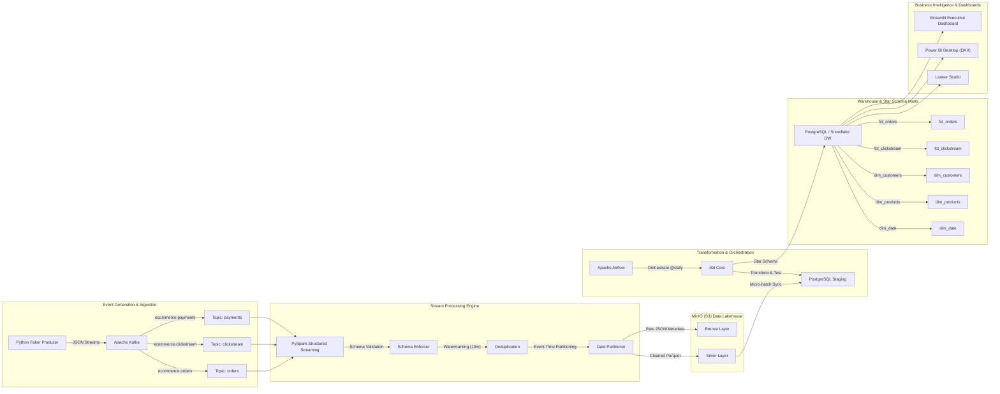

# Streaming E-Commerce Data Platform

An enterprise-grade, end-to-end real-time data engineering platform that continuously ingests simulated e-commerce customer behavior and transaction events, cleans and models them using a Medallion Lakehouse pattern, transforms them into a Star Schema with **dbt**, and serves analytical dashboards for revenue and customer funnel insights.

---

## 1. System Architecture



---

## 2. Key Features

- **Real-Time Streaming**: Ingests orders, payments, and multi-step clickstreams (`view` ➔ `add_to_cart` ➔ `checkout` ➔ `purchase`) continuously via Kafka.
- **Medallion Lakehouse Architecture**:
  - **Bronze**: Raw events with Kafka offset, partition, and arrival timestamp.
  - **Silver**: Schema-validated, typed, deduplicated records with 10-minute watermarks, partitioned by event date (`order_date`, `event_date`).
  - **Gold**: Business-ready dimensional star schema and aggregated analytical rollups.
- **Star Schema Data Modeling**:
  - Fact tables: `fct_orders`, `fct_clickstream`.
  - Dimension tables: `dim_customers`, `dim_products`, `dim_date`.
- **Data Quality & Testing with dbt**:
  - Automated tests for primary key uniqueness, null checks, accepted value checks, and foreign key referential integrity relationships.
  - Custom test asserting that total settled payments equal completed order amounts.
- **Airflow Orchestration**:
  - Daily DAG refreshes staging, triggers dbt runs and test assertions, and generates executive health notifications.
  - 15-minute streaming health check DAG monitors Kafka lag and MinIO partition growth.
- **Multi-Engine Warehouse Support**:
  - Ready-to-run local **PostgreSQL 16** warehouse.
  - Production-ready DDL and Snowpipe definitions for **Snowflake**.
- **Interactive Analytics Dashboards**:
  - **Streamlit** live executive dashboard with Plotly charts.
  - **Power BI** DAX measures and dimensional model layout guide.
  - **Looker Studio** connection instructions and SQL views.

---

## 3. Data Model (Star Schema)

The platform implements an industry-standard dimensional star schema:

| Table | Type | Key Columns | Description |
| :--- | :--- | :--- | :--- |
| `fct_orders` | Fact | `order_id` (PK), `customer_key` (FK), `product_key` (FK), `date_key` (FK), `quantity`, `revenue` | Core sales transaction measurements |
| `fct_clickstream` | Fact | `event_id` (PK), `customer_key` (FK), `product_key` (FK), `date_key` (FK), `event_type`, `event_timestamp` | Browsing sessions, funnel actions, device context |
| `dim_customers` | Dimension | `customer_key` (PK), `customer_id` (Natural), `name`, `city`, `state`, `country`, `signup_date` | Descriptive customer attributes |
| `dim_products` | Dimension | `product_key` (PK), `product_id` (Natural), `name`, `category`, `price` | Product catalog hierarchy and pricing |
| `dim_date` | Dimension | `date_key` (PK, YYYYMMDD), `date`, `month`, `quarter`, `year`, `day_name`, `is_weekend` | Standard calendar dimension |

---

## 4. Quick Start & Execution

### Option A: Complete Docker Compose Stack (Recommended)

Run all services locally in Docker with a single command:

```bash
# 1. Clone repository and navigate to folder
cd streaming-ecommerce-platform

# 2. Copy environment template
cp .env.example .env

# 3. Start all services in background
docker compose up -d --build
```

#### Access Web Interfaces

| Service | URL | Credentials / Notes |
| :--- | :--- | :--- |
| **Streamlit Dashboard** | [http://localhost:8501](http://localhost:8501) | Live revenue, conversion funnel, DAU |
| **Kafka Web UI** | [http://localhost:8080](http://localhost:8080) | Topic inspection, consumer groups, raw messages |
| **MinIO Console** | [http://localhost:9001](http://localhost:9001) | `minioadmin` / `minioadmin` (Data Lake) |
| **Apache Airflow** | [http://localhost:8085](http://localhost:8085) | `admin` / `admin` (DAG orchestrator) |
| **Apache Spark UI** | [http://localhost:8081](http://localhost:8081) | Spark master and worker metrics |
| **PostgreSQL DW** | `localhost:5432` | DB: `ecommerce_dw`, User: `postgres`, Pass: `postgres` |

---

### Option B: Standalone Local Demo (No Docker Required)

If you wish to test the entire pipeline logic, data generation, deduplication, star-schema modeling, and analytical metrics calculations directly on your workstation without Docker:

```bash
# 1. Install dependencies
pip install -r requirements.txt

# 2. Run the end-to-end simulation script
python scripts/run_local_demo.py
```

### Option C: Run Unit & Pipeline Tests

```bash
pytest tests/ -v
```

---

## 5. Sample Analytical Queries & Business Metrics

The warehouse enables critical e-commerce metric analysis using the queries in [`sql/sample_queries.sql`](./sql/sample_queries.sql):

### 1. Total Revenue and Orders Per Day
```sql
SELECT
    d.date,
    COUNT(DISTINCT f.order_id) AS total_orders,
    SUM(f.quantity) AS total_units_sold,
    ROUND(SUM(f.revenue), 2) AS total_revenue,
    ROUND(AVG(f.revenue), 2) AS avg_revenue_per_order
FROM warehouse.fct_orders f
JOIN warehouse.dim_date d ON f.date_key = d.date_key
GROUP BY d.date
ORDER BY d.date DESC;
```

### 2. E-Commerce Conversion Funnel
```sql
WITH funnel_steps AS (
    SELECT
        COUNT(DISTINCT CASE WHEN c.event_type = 'view' THEN c.session_id END) AS view_sessions,
        COUNT(DISTINCT CASE WHEN c.event_type = 'add_to_cart' THEN c.session_id END) AS cart_sessions,
        COUNT(DISTINCT CASE WHEN c.event_type = 'checkout' THEN c.session_id END) AS checkout_sessions
    FROM warehouse.fct_clickstream c
),
purchase_steps AS (
    SELECT COUNT(DISTINCT order_id) AS purchase_orders
    FROM warehouse.fct_orders
    WHERE order_status = 'COMPLETED'
)
SELECT
    f.view_sessions,
    f.cart_sessions,
    ROUND(f.cart_sessions * 100.0 / NULLIF(f.view_sessions, 0), 2) AS view_to_cart_pct,
    f.checkout_sessions,
    ROUND(f.checkout_sessions * 100.0 / NULLIF(f.cart_sessions, 0), 2) AS cart_to_checkout_pct,
    p.purchase_orders,
    ROUND(p.purchase_orders * 100.0 / NULLIF(f.checkout_sessions, 0), 2) AS checkout_to_purchase_pct,
    ROUND(p.purchase_orders * 100.0 / NULLIF(f.view_sessions, 0), 2) AS overall_conversion_rate_pct
FROM funnel_steps f
CROSS JOIN purchase_steps p;
```

### 3. Revenue by Product Category
```sql
SELECT
    p.category,
    COUNT(DISTINCT f.order_id) AS total_orders,
    SUM(f.quantity) AS total_quantity_sold,
    ROUND(SUM(f.revenue), 2) AS total_revenue,
    ROUND(SUM(f.revenue) * 100.0 / SUM(SUM(f.revenue)) OVER (), 2) AS revenue_share_pct
FROM warehouse.fct_orders f
JOIN warehouse.dim_products p ON f.product_key = p.product_key
GROUP BY p.category
ORDER BY total_revenue DESC;
```

### 4. Top 10 Customers by Lifetime Spend
```sql
SELECT
    c.customer_id,
    c.name,
    c.city,
    c.state,
    COUNT(DISTINCT f.order_id) AS total_orders,
    ROUND(SUM(f.revenue), 2) AS total_spend,
    ROUND(AVG(f.revenue), 2) AS avg_spend_per_order
FROM warehouse.fct_orders f
JOIN warehouse.dim_customers c ON f.customer_key = c.customer_key
GROUP BY c.customer_id, c.name, c.city, c.state
ORDER BY total_spend DESC
LIMIT 10;
```

---

## 6. Directory Structure

```
streaming-ecommerce-platform/
├── docker-compose.yml              # All-in-one orchestrated container stack
├── .env.example                    # Environment settings and credentials
├── requirements.txt                # Python project dependencies
├── README.md                       # Complete architecture and operations guide
│
├── producers/                      # Event generation with Python Faker
│   ├── Dockerfile
│   ├── config.py                   # Producer settings and topic names
│   ├── schema.py                   # Pydantic models for orders, clicks, payments
│   ├── generator.py                # Funnel simulator (view -> cart -> checkout -> order)
│   ├── kafka_producer.py           # Resilient Kafka producer with retry & dry-run
│   └── run_producer.py             # CLI entrypoint for continuous event streaming
│
├── spark/                          # Spark Structured Streaming engine
│   ├── Dockerfile
│   ├── schemas/                    # StructType schemas for streaming deserialization
│   │   └── event_schemas.py
│   ├── utils/
│   │   ├── spark_session.py        # SparkSession with S3A MinIO connector
│   │   └── quality_checks.py       # Deduplication, watermarking, null filtering
│   ├── streaming_pipeline.py       # Main streaming job: Kafka -> Bronze & Silver in MinIO
│   └── silver_to_dw_loader.py      # Microbatch sync: MinIO Silver -> Postgres staging
│
├── minio/                          # Object storage init
│   └── create_buckets.sh           # Bucket creation script for MinIO Client (mc)
│
├── dbt_ecommerce/                  # dbt project for star-schema transformations
│   ├── dbt_project.yml
│   ├── profiles.yml                # Configured for PostgreSQL & Snowflake
│   ├── models/
│   │   ├── staging/                # Staging views with deduplication & cleaning
│   │   │   ├── schema.yml          # Source and staging tests
│   │   │   ├── stg_orders.sql
│   │   │   ├── stg_clickstream.sql
│   │   │   ├── stg_payments.sql
│   │   │   ├── stg_customers.sql
│   │   │   └── stg_products.sql
│   │   └── marts/
│   │       ├── core/               # Star Schema Fact & Dimension Tables
│   │       │   ├── schema.yml      # Referential integrity & uniqueness tests
│   │       │   ├── dim_customers.sql
│   │       │   ├── dim_products.sql
│   │       │   ├── dim_date.sql
│   │       │   ├── fct_orders.sql
│   │       │   └── fct_clickstream.sql
│   │       └── analytics/          # Business rollups
│   │           ├── agg_daily_sales.sql
│   │           ├── agg_conversion_funnel.sql
│   │           └── agg_customer_rfm.sql
│   └── tests/
│       └── assert_order_total_matches_payments.sql
│
├── airflow/                        # Airflow DAGs and plugins
│   ├── Dockerfile
│   └── dags/
│       ├── ecommerce_daily_warehouse_refresh.py  # Daily dbt & warehouse sync
│       └── ecommerce_stream_monitor.py           # Streaming partition monitor
│
├── sql/                            # Warehouse DDL and analytical query scripts
│   ├── 01_init_warehouse.sql       # PostgreSQL DDL, staging tables, and seed data
│   ├── sample_queries.sql          # Required analytical metrics queries
│   └── snowflake_setup.sql         # Snowflake cloud DDL & Snowpipe configs
│
├── dashboard/                      # Visualizations and BI reporting
│   ├── Dockerfile
│   ├── app.py                      # Interactive Streamlit executive dashboard
│   ├── powerbi/
│   │   ├── PowerBI_Architecture_Guide.md # Step-by-step connection guide
│   │   ├── measures_and_dax.dax    # Ready-to-use DAX measures
│   │   └── schema_model.json       # Power BI relationship layout
│   └── looker_studio/
│       └── LookerStudio_Guide.md   # Looker Studio connection guide
│
├── tests/                          # Automated test suite
│   ├── test_generator.py           # Unit tests for Faker generator
│   ├── test_schemas.py             # Schema validation tests
│   ├── test_spark_transformations.py # Mocked PySpark cleaning tests
│   └── test_dbt_models_sql.py      # SQL syntax and star schema validation tests
│
└── scripts/                        # Utility scripts
    ├── setup.ps1 / setup.sh        # Windows & Linux bootstrap scripts
    ├── generate_sample_data.py     # Static sample dataset generator
    └── run_local_demo.py           # In-process pipeline simulator
```

---

## 7. License

Licensed under the Apache License 2.0. Feel free to customize and extend for your data engineering portfolio and production workloads.
